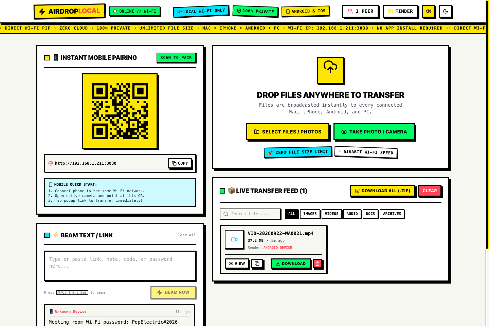
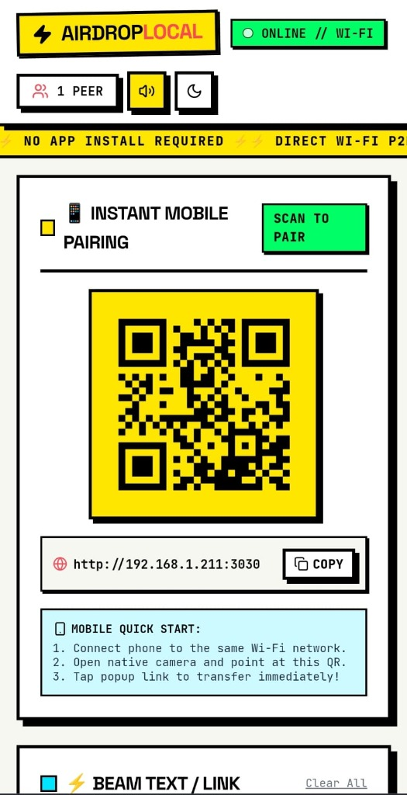

<div align="center">

# ⚡ AIRDROP LOCAL
### Neo-Brutalist P2P Wi-Fi Transfer & Live Clipboard Beam

[](LICENSE)
[](#)
[](#)
[](#visual--ui-design-system)

<p align="center">
  <b>Bidirectional cross-platform local file sharing and text sync across Mac, iPhone, Android, and PC.</b><br />
  Zero apps to install • Zero cloud accounts • 100% direct LAN streaming over your local Wi-Fi router.
</p>

---

### 🖥️ Desktop Web Interface (Neo-Brutalist Kinetic UI)


<br /><br />

<table align="center" width="100%">
  <tr>
    <td width="35%" align="center" valign="top">
      <h4>📱 Mobile View (iOS / Android)</h4>
      
    </td>
    <td width="65%" align="center" valign="top">
      <h4>⚡ Instant Mobile Pairing (Scan with Camera)</h4>
      <br />
      <p align="left">
        No app downloads required. Simply point any iPhone or Android camera at the QR code on your Mac screen to open the web app instantly!
      </p>
      <br />
      <ul align="left">
        <li>🚀 <b>Zero Installation:</b> Runs directly in Safari, Chrome, Edge, and Firefox</li>
        <li>⚡ <b>Gigabit Wi-Fi Speed:</b> Uncapped LAN transfer rates directly via your router</li>
        <li>🔒 <b>100% Air-Gapped Privacy:</b> Files never touch any external server or cloud</li>
        <li>📸 <b>Camera Direct Snap:</b> Take photos directly on phone and beam to Mac in 1 tap</li>
      </ul>
    </td>
  </tr>
</table>

</div>

---

## ⚡ Why AirDrop Local?

| Feature | ⚡ AirDrop Local | 🍏 Apple AirDrop | 🤖 Nearby Share | ☁️ WeTransfer / Drive |
|---|:---:|:---:|:---:|:---:|
| **Zero App Installation** | ✅ **100% Web (Zero install)** | ❌ Apple only | ❌ Google account | ❌ Requires upload wait |
| **Cross-Platform** | ✅ **Mac ⇄ iPhone ⇄ Android ⇄ PC** | ❌ Apple ecosystem only | ❌ Android/Windows only | ⚠️ Needs web account |
| **Local LAN Privacy** | ✅ **100% Private (No Cloud)** | ✅ P2P BLE/Wi-Fi | ⚠️ Cloud telemetry | ❌ Third-party cloud servers |
| **File Size Limits** | 🚀 **Unlimited (Gigabytes ok)** | ⚠️ Drops on big batches | ⚠️ 10 GB limits | ❌ 2 GB cap / slow speeds |
| **Live Clipboard Beam** | ✅ **Instant Text & Link Sync** | ⚠️ Universal Clipboard (Mac/iOS only) | ❌ No | ❌ Manual messaging |
| **In-Browser Media Player** | ✅ **Stream Video, Audio, PDF & Code** | ❌ No | ❌ No | ⚠️ Transcoded / delayed |

---

## 🎨 Visual & UI Design System (Concept D: Neo-Brutalist)

Styled following **Kinetic UI Archetype 028: Concept D (Neo-Brutalist / Electric Pop)**:

- **Color Tokens:**
  - `Canvas`: Off-white / Cream `#F7F7F2` with Stark Black `#0A0A0A` dark mode support
  - `Accent 1 (Primary Pop)`: Electric Yellow `#FFE600`
  - `Accent 2 (Signal / Success)`: Acid Green `#00FF66`
  - `Accent 3 (Attention)`: Hot Coral `#FF4757` & Electric Cyan `#00E5FF`
  - `Ink & Borders`: Pitch Black `#000000` with 3px solid borders (`border-3 border-black`)
- **Brutalist Physics & Surfaces:**
  - Solid, unblurred 4px & 6px hard drop shadows (`box-shadow: 4px 4px 0px #000000`, `6px 6px 0px #000`)
  - Tactile button press micro-interaction (`active:translate-x-[2px] active:translate-y-[2px]`)
  - Playful tilted sticker badges (`⚡ LOCAL WI-FI ONLY`, `🔒 NO CLOUD / 100% PRIVATE`, `📱 ANDROID & iOS READY`, `🚀 ZERO LIMITS`)
  - Desktop kinetic brutalist pointer with snapping micro-interaction (automatically disabled on touch screens)
- **Typography Trio:**
  - Display: **Space Grotesk** & **Syne** (Extra Bold 800/900)
  - Telemetry & Code: **JetBrains Mono** for file sizes, IPs, and transfer speeds
- **Procedural Haptic Audio (Web Audio API):**
  - Tactile pops on button clicks, ascending celebratory fanfare for file completion, 2-tone arpeggio for incoming text beams, snappy chirp on clipboard copy, and prominent mute toggle.

---

## 🚀 Quickstart Guide

### 1. Clone & Install
```bash
git clone https://github.com/i-m-champion/AirDrop.git
cd AirDrop
npm install
```

### 2. Launch
```bash
npm start
```
> The startup command automatically compiles frontend assets (`npm run build`) and starts the server with **automatic port-conflict fallback** (e.g. `3030`, `3031` if `3000` is busy).

Upon launch, an ASCII QR code is rendered directly in your terminal:

```text
================================================================
⚡  AIRDROP LOCAL // NEO-BRUTALIST P2P WI-FI TRANSFER
================================================================
📡 Host Machine : Ayushs-MacBook-Air-5.local (darwin)
🌐 Primary Wi-Fi: 192.168.1.211:3030
🔗 Browser Link : http://192.168.1.211:3030
================================================================
📱 SCAN WITH IPHONE / ANDROID CAMERA TO PAIR INSTANTLY:

  ▄▄▄▄▄▄▄ ▄ ▄ ▄▄▄▄▄▄▄
  █ ▄▄▄ █ ▄ ▄ █ ▄▄▄ █
  █ ███ █ █ █ █ ███ █
  █▄▄▄▄▄█ █ █ █▄▄▄▄▄█
  ▄▄▄▄▄ ▄▄█ █▄ ▄ ▄ ▄ 
  █ ▄ █▄▄▀ ▄▀ ▄▀██ █ 
  █ █▄▄▄█ █ ▄▄ █▄██ █
  █▄▄▄▄▄▄▄█ █ ▀ █ █▄█

⚡ Status: Server listening on 0.0.0.0:3030
🔒 Privacy: 100% Local Wi-Fi Router Only (Zero External Cloud)
================================================================
```

### 3. One-Click Launchers on Mac
You can also open the web app anytime simply by double-clicking:
- **`Launch AirDrop.command`**: macOS executable that checks if the server is active, starts it if needed, and launches the browser.
- **`Open AirDrop.html`**: Instant universal browser redirect file.
- **`Open AirDrop.webloc`**: Native macOS Web Location shortcut.

---

## 📱 Dual Responsive Layout Architecture

```text
┌────────────────────────────────────────────────────────────────────────────────────────┐
│  ⚡ AIRDROP LOCAL    [● ONLINE // WI-FI]    [⚡ LOCAL WI-FI] [🔒 100% PRIVATE]    [🔊] [🌓] │
├────────────────────────────────────────────────────────────────────────────────────────┤
│  ⚡ DIRECT WI-FI P2P ⚡ ZERO CLOUD ⚡ 100% PRIVATE ⚡ UNLIMITED FILE SIZE ⚡ MAC • PHONE ⚡   │
├──────────────────────────────────────────┬─────────────────────────────────────────────┤
│  📱 INSTANT MOBILE PAIRING               │  ☁️ DROP FILES ANYWHERE TO TRANSFER         │
│  ┌────────────────────────────────────┐  │  ┌───────────────────────────────────────┐  │
│  │     [ ELECTRIC YELLOW QR CODE ]    │  │  │   [ 📁 SELECT FILES ] [ 📸 CAMERA ]   │  │
│  │                                    │  │  └───────────────────────────────────────┘  │
│  │  🌐 http://192.168.1.211:3030 [COPY]│  ├─────────────────────────────────────────────┤
│  └────────────────────────────────────┘  │  ⚡ UPLOADING 3 FILES... [ 18.4 MB/s ] 78%  │
│                                          │  [████████████████████████████████░░░░░░░]  │
│  ⚡ BEAM TEXT / LINK                     ├─────────────────────────────────────────────┤
│  ┌────────────────────────────────────┐  │  📦 LIVE TRANSFER FEED (4 Files)            │
│  │ [Type or paste note / URL / code]  │  │  [Search...] [ALL] [IMAGES] [VIDEOS] [DOCS] │
│  │               [⚡ BEAM TO PEERS]   │  │  ┌───────────────────────────────────────┐  │
│  └────────────────────────────────────┘  │  │ 📹 Video_001.mp4  (37 MB)  [DOWNLOAD] │  │
│  • iPhone: https://github.com/.. [COPY]  │  │ 🖼️ Snapshot.jpg   (4.2 MB) [PREVIEW]  │  │
│  • Mac: Wi-Fi password: secret   [COPY]  │  │ 📦 Bundle.zip     (120 MB) [DOWNLOAD] │  │
│                                          │  └───────────────────────────────────────┘  │
└──────────────────────────────────────────┴─────────────────────────────────────────────┘
```

---

## 🛠 Project Structure

```text
AirDrop/
├── server/
│   ├── banner.js          # Terminal ASCII QR code and startup art
│   ├── beam.js            # Live clipboard / text sync storage
│   ├── device.js          # User-Agent device parsing & labels
│   ├── index.js           # Express + WebSocket HTTP server & dynamic port hunter
│   ├── network.js         # Interface discovery & Wi-Fi IP detection
│   ├── routes.js          # REST API endpoints (upload, preview, zip, finder)
│   ├── storage.js         # File metadata registry & disk manager
│   ├── upload.js          # Multer streaming disk storage engine
│   └── websocket.js       # Real-time peer presence & event broadcasting
├── src/
│   ├── components/
│   │   ├── BeamCard.jsx          # Live text / link beam sync
│   │   ├── BrutalistCursor.jsx   # Desktop kinetic cursor
│   │   ├── DropZone.jsx          # Tactile drag-and-drop dropzone
│   │   ├── FileList.jsx          # Live file stream & download actions
│   │   ├── Header.jsx            # Brand masthead, stickers, peer counter
│   │   ├── MarqueeBanner.jsx     # High-voltage infinite ticker
│   │   ├── PairingCard.jsx       # QR pairing card with IP selector
│   │   ├── PeersModal.jsx        # Active peer device inspector
│   │   ├── PreviewModal.jsx      # Lightbox preview (images, video, audio, code)
│   │   ├── Toast.jsx             # Brutalist alert notifications
│   │   └── UploadProgress.jsx    # Real-time bandwidth gauge
│   ├── hooks/
│   │   └── useAirDropSocket.js   # Real-time WebSocket synchronization hook
│   ├── utils/
│   │   ├── format.js             # Byte formatting, mime lookup & time ago
│   │   └── sound.js              # Web Audio procedural synthesizer
│   ├── App.jsx                   # Dual responsive layout container
│   ├── index.css                 # Neo-Brutalist design tokens & physics
│   └── main.jsx                  # React application entry
├── docs/
│   └── screenshots/              # High-resolution application screenshots
├── uploads/                      # Local storage directory for transferred files
├── Launch AirDrop.command        # macOS double-clickable launcher
├── Open AirDrop.html             # Universal browser redirect shortcut
├── Open AirDrop.webloc           # Native macOS Web Location
├── LICENSE                       # MIT License
├── package.json                  # Scripts & dependencies
├── tailwind.config.js            # Neo-Brutalist color palette & hard shadows
└── vite.config.js                # Vite build configuration
```

---

## 📡 REST API Reference

| Method | Endpoint | Description |
|---|---|---|
| `GET` | `/api/info` | Returns host Wi-Fi IP, platform, telemetry, and storage statistics |
| `GET` | `/api/qr` | Generates a high-contrast Neo-Brutalist QR code data URL |
| `GET` | `/api/files` | Lists all uploaded files with metadata |
| `POST` | `/api/upload` | Multi-file streaming upload (Multer disk storage) |
| `GET` | `/api/download/:filename` | Downloads target file with attachment headers |
| `GET` | `/api/preview/:filename` | Streams inline preview with HTTP 206 partial range seeking |
| `DELETE` | `/api/files/:id` | Deletes a file from the server |
| `DELETE` | `/api/files` | Clears all files from the server |
| `GET` | `/api/download-all` | Streams all current files as a `.zip` archive |
| `POST` | `/api/open-folder` | Opens the `./uploads` folder in macOS Finder (`open uploads`) |
| `GET` | `/api/beam` | Returns text / clipboard beam history |
| `POST` | `/api/beam` | Broadcasts text snippet / URL to all connected peers |
| `DELETE` | `/api/beam/:id` | Deletes a beamed snippet |

---

## 📄 License

MIT License © 2026 [i-m-champion](https://github.com/i-m-champion). Built with passion for local privacy, zero-cloud independence, and high visual craft.
